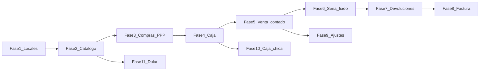

# Construcción por fases

La base ya está: tenancy híbrido, panel `admin` y panel `negocio` en [app/Providers/Filament/NegocioPanelProvider.php](app/Providers/Filament/NegocioPanelProvider.php). El pool solo tiene `users` ([config/tenant-pools.php](config/tenant-pools.php)). El contrato es [esstructuraybasecondiciones.md](esstructuraybasecondiciones.md). No se reescribe esa base.

Cada fase agrega migraciones en `database/migrations/tenant`, modelos con `BelongsToTenantPool`, el único `(tenant_id, id)` y las foreign keys compuestas. Las tablas nuevas entran en `config/tenant-pools.php` con las hijas antes que los padres. Los tests son Pest y no tocan Postgres local.

## Dónde va cada pantalla

- Recursos Filament en `app/Filament/Negocio/Resources`: sucursales, almacenes, categorías, productos, clientes, tipos de documento de identidad, proveedores, compras, ajustes, traslados, categorías de gasto, impuestos, tipo de cambio. El resource de talonarios queda con la fase 8, pospuesta el 11 de noviembre de 2026.
- Abrir/cerrar caja es una página Filament (`CajaDelNegocio`), no un resource de listado completo ni el mostrador.
- El mostrador es `MostradorDelNegocio` + Livewire `app/Livewire/Negocio/Venta/Mostrador`: buscador, líneas, flash, cobros y adjuntos.
- La devolución del mismo día usa el mismo estilo Livewire, no un formulario genérico.
- El vale de caja chica tampoco es un resource. Vive en la página de la caja abierta, como un paso corto: monto, concepto, categoría y comprobante. El listado histórico puede ser una tabla Filament de solo lectura.

## Fase 1. Locales, configuración y permisos — hecha

Tablas: `negocio_configuracion`, `sucursales`, `almacenes`, `sucursal_almacenes`. No se agrega columna `rol` en `users`.

Permisos: Filament Shield en el panel `negocio`, con Spatie y equipos. El equipo es el `tenant_id`. Las tablas de roles y permisos viven en el pool, no en la central, y entran en la lista de limpieza. Al crear un negocio se siembran hoy dos roles: `cajero` y `supervisor`. El panel `admin` de la plataforma no usa el `super_admin` de Shield: el rol de plataforma es `admin`.

Reglas: el tenant es el negocio; `tenant_id` en todo el pool; el almacén no tiene `sucursal_id`; la pivote es el único vínculo y `es_principal` vive ahí; un almacén compartido es dos filas de la misma pila; dos saldos distintos son dos almacenes. `moneda` nace en `BOB` y `modo_moneda` en `solo_moneda` *(Pendiente: evaluar migrar `moneda` a `varchar(3)` ISO 4217 para no limitar el SaaS a 3 países)*. El dólar no aparece todavía. Las fases siguientes deben autorizar por **permiso** Shield/Spatie, no por nombre de rol hardcodeado ni por columna en `users`.

Pantalla: resources de sucursales y almacenes, y asignar almacenes a la sucursal. El rol de Shield se asigna al crear el usuario del negocio. El cajero no administra roles.

Tener en cuenta (no está — ver `esstructuraybasecondiciones.md` punto 15 y futuros 11 y 14):
- Plantilla **`encargado`** (matriz: usuarios, roles, sucursales, config + ver todas las sucursales). `supervisor` operativo sin administración del sistema. Roles custom en Shield sin tocar código. No roles por sucursal. No `super_admin` de Shield.
- Pivote `user_sucursales` + **switch de sucursal en el menú** (contexto de operación). Usuarios y roles **fuera** del switch. Hoy cualquiera ve todas las sucursales. No implementarlo en esta fase.

## Fase 2. Catálogo — hecha

Tablas: `unidades_medida`, `categorias`, `categoria_atributos`, `marcas`, `productos_maestros`, `productos_variantes`, `inventario_stocks` en cero. No existe `categorias.plantilla_atributos`. La marca no es un atributo de la categoría: es `marcas.nombre`, único por negocio sin distinguir mayúsculas, y `productos_maestros.marca_id`. En la limpieza del pool, `productos_maestros` sale antes que `marcas`, y `categoria_atributos` antes que `categorias` y que `unidades_medida`.

Reglas: SKU único por negocio; código de barras único si existe y el vacío puede repetirse. La ficha del rubro es `categoria_atributos`: clave, etiqueta, tipo (`decimal`, `texto` o `lista`), obligatorio, orden y `unidad_medida_id` nulo cuando el campo no se mide. No hay una unidad «sin unidad». Los valores van en `atributos_json`: el decimal como número JSON, el texto y la lista como texto, sin copiar la unidad. Índice GIN para la igualdad dentro del negocio y de la categoría. La variante no agrega claves fuera de su categoría. Ubicación en el stock, no en la variante. `precio_venta` y `precio_mayor` en la moneda de la tienda. Las columnas en dólares se crean vacías y no se usan hasta la fase 11.

Pantalla: resource de unidades y de categorías, con los atributos de la ficha en la categoría. Resource de productos con variantes: el formulario arma los campos desde `categoria_atributos` y guarda los valores ya tipados. Stock inicial en cero por almacén. Sin kardex todavía: no se puede “poner cantidad” a mano.

Tener en cuenta (hablarlo después): si el vendedor busca acá y no en el mostrador, ayudarlo a no retrucar. En la tabla/ficha de la variante: copiar SKU (o código de barras) y/o una acción **Agregar al mostrador** que abra el cobro con esa pieza. No cobrar desde el catálogo. Ver `esstructuraybasecondiciones.md` futuro ítem 12.

## Fase 3. Compras y costo promedio — hecha

Tablas: `proveedores`, `proveedor_contactos`, `trabajadores`, `ordenes_compra`, `orden_compra_detalles`, `movimientos_inventario`. Al crear el negocio se inserta el proveedor ocasional, uno solo.

Reglas: el kardex solo se inserta, con stock previo, posterior y usuario; el costo va en `decimal(14,4)`; cada compra guarda su costo y el producto guarda el promedio; antes de guardar, la pantalla muestra el costo por unidad y pide confirmación; la compra no cambia el precio de venta; no hay stock negativo.

Pantalla: resource de compras y de proveedores. Recibir mercadería escribe stock y kardex. La entrada express queda para la fase 5, porque nace desde el mostrador.

## Fase 4. Clientes, impuestos y caja — hecha

Tablas: `clientes`, `tipos_documento_identidad`, `tipo_documento_atributos`, `cliente_documentos`, `impuestos`, `cajas_sesiones`.

Reglas cubiertas:
- Cliente sin moneda propia; `tipo_precio` `menor` | `mayor` (v1; listas estilo Odoo quedan a futuro en el doc maestro).
- `tipo_cliente` persona natural | empresa: persona usa `nombres` + `apellidos` (y se arma `razon_social` para listar); empresa usa `razon_social`.
- Documentos de identidad **configurables** (no un solo `nit_ci`): catálogo por tenant (CI, NIT sembrados al nacer), atributos dinámicos (texto/decimal/lista, obligatorio, identifica), valores en `cliente_documentos.valores_json` + `identidad` única por tipo.
- Impuestos: catálogo con porcentaje; en la venta se copiará el snapshot (fase 5).
- Caja: una sesión abierta por `(tenant, sucursal, user)`; se puede cerrar y abrir otra el mismo día; si hay diferencia, justificación obligatoria; el cierre no mira vales (fase 10).

Pantalla: resources Clientes, Impuestos, Tipos de documento; página Filament Abrir/Cerrar caja (historial corto del cajero).

Arqueo del turno (cierre de 4/5): al cerrar se declara **cada medio** (efectivo contado + QR/transferencia/voucher confirmados). Esperado: efectivo = apertura + cobros − reembolsos; otros = neto del turno. Si algún medio no calza, justificación obligatoria. Snapshot en `caja_sesion_medios`. Todos los cobros del contado cuelgan de `pagos.caja_sesion_id`. Vista supervisor **Cajas del día**: consolidado por sucursal + fecha. El faltante es solo de turnos cerrados; lo abierto queda pendiente de contar. Un turno de otro día se congela y se puede abrir el de hoy. Turno sin ventas se anula. Falta amarrar sucursales a cargo. Egresos de caja chica: fase 10.

## Fase 5. Venta de contado — hecha

Tablas: `ventas`, `venta_detalles`, `venta_impuestos`, `pagos`, `pago_aplicaciones`. `siguiente_numero_venta` ya en configuración.

Reglas cubiertas: código `VNT-`; almacén en pivote de sucursal; lock de stock; contado con caja abierta; descuento %/importe con tope y supervisor; alerta PPP sin bloquear; `nota_venta`; snapshot de impuestos; cobros multi-método (`efectivo`, `qr_externo`, `voucher_tarjeta`, `transferencia`) sin pasarela; adjunto local por pago; factory de handlers de método de pago.

Pantalla: `MostradorDelNegocio` + Livewire `Mostrador`. Compra flash completa (pieza existente o alta al vuelo) con ocasional y `entrada_flash_emergencia`. El descuento visible es el del ticket (derecha, «Agregar descuento»), % o importe, con los topes de configuración. El de línea existe en el detalle y no se muestra.

Tener en cuenta (no está en la pantalla): si el descuento pasa el tope, `CompletarVentaContado` exige `supervisor_descuento_id` y la venta no cierra, pero nadie tipea clave. Pendiente, sin abrir otra fase: (1) dentro del tope, el cajero reingresa su contraseña para dejar huella; (2) pasado el tope, modal con usuario y contraseña de un supervisor del mismo negocio, y se guarda ese id. No alcanza un select de supervisor. El mismo modal sirve después para anular y devolver. Ver `esstructuraybasecondiciones.md` punto 25 y futuro ítem 3. La promo por producto se carga en la ficha de la variante, no acá (futuro ítem 2).

Tener en cuenta: el catálogo puede mandar una variante acá (SKU copiado o «Agregar al mostrador»). El mostrador ya agrega por id (`seleccionarResultado`). Cuando se arme la acción en productos, reutilizar eso. Ver futuro ítem 12.

Tener en cuenta: el select de sucursal del mostrador lista todas las activas. Cuando exista la asignación (fase 1 / futuro ítem 11), acá solo van las del usuario y la que eligió al iniciar sesión. Hasta entonces no filtrar.

Tener en cuenta (hablarlo después): aviso al cobrar **sin cliente**. Hoy el contado puede ir sin ficha («Mostrador · Consumidor final») y eso es válido. Un modal de «¿estás seguro?» en cada nota frena el mostrador y el cajero lo salta. No implementarlo ahora. Cuando se hable: no bloquear el cobro de todos los días; si hay aviso, que sea suave o solo cuando sin cliente la venta queda mal (factura, seña, fiado: ahí ya es obligatorio, no pregunta). Opcional: chip visible, o preguntar solo si el total o el descuento son altos.

**Cierre de entrada express:** antes de «Confirmar entrada» se exige el check «Confirmo estos costos por unidad», igual que al recibir mercadería. Producto existente o alta mínima (nombre, cantidad, costo y precio; SKU opcional, General / pza, sin marca). Compra ocasional completada con kardex y PPP, sin mover caja. En la vista de Compras, «Asignar proveedor real» requiere permiso de actualizar y solo cambia proveedor/contacto, sin repetir stock ni costos. El proveedor se crea en su catálogo. Egreso de caja: fase 10; corrección de costo: fase 9.

## Fase 6. Seña, fiado y adelanto

**Estado al 9 de noviembre de 2026:** cerrada con el alcance acordado. El usuario ejecutó la suite completa: 163 pruebas aprobadas y 1.419 comprobaciones en 337,40 segundos. El detalle de lo implementado, los límites actuales y las mejoras futuras está en [fase_6_estado_actual.md](fase_6_estado_actual.md).

Implementado: venta a crédito con cliente y cobro parcial opcional, abonos en efectivo desde Mis ventas, reserva con cliente/seña/vencimiento, entrega con cobro del saldo en efectivo y procesamiento de vencidas al operar que libera unidades y registra la seña a favor del cliente.

Decisión comercial vigente para reservas: una seña al crear y el saldo completo al retirar. Los abonos sucesivos de una reserva quedan fuera del flujo actual.

Implementado también al 7 de noviembre de 2026: aplicación del saldo a favor en Mostrador y reembolso parcial o total de señas vencidas con permiso, motivo y caja actual. La condición de reembolso se configura por negocio y se copia en cada reserva.

Implementado también: cancelación de reservas vigentes con View:Venta y Update:Venta, motivo, usuario y fecha. Conserva el documento como Anulada, libera las unidades apartadas y deja la seña a favor sin mover caja. El reembolso posterior respeta la condición guardada y exige Reembolsar:Sena y caja actual.

Implementado: ampliación del vencimiento de reservas vigentes mediante Ampliar:Reserva y permiso de consulta, con motivo e historial de cambios. El permiso puede asignarse a un rol o directamente a un usuario.

Al crear reservas se proponen las 23:59 del día calculado con horas_reserva. Al ampliar se propone el día siguiente al vencimiento vigente a las 23:59. Ambas horas son editables. Si el pago cubre el total, un aviso orienta a elegir Contado cuando el cliente retira los productos en ese momento.

Mostrador permite consultar y preparar operaciones sin caja. La confirmación requiere la caja de hoy en la sucursal, y el aviso permite abrir Caja en otra pestaña y actualizar el estado sin perder el carrito.

Verificación de cierre completada con la suite completa. El cobro del saldo al entregar y los abonos posteriores siguen en efectivo; ampliar sus métodos de pago queda pendiente de definir como mejora posterior. El 9 de noviembre se implementó vuelto/cambio como ampliación posterior: recibido y cambio por cobro en efectivo, incluidos pagos combinados, señas, abonos y retiro de reservas, sin generar vuelto electrónico ni alterar el importe aplicado en caja. Esta ampliación tiene sus pruebas propias; el resultado de cierre corresponde a la versión anterior.

Pospuesto por decisión del 7 de noviembre de 2026: adelantos de clientes sin productos y aplicación de un mismo pago a varias ventas pendientes. No bloquean el cierre de la fase 6 y todavía no tienen fase futura asignada. Mientras tanto, las señas se reciben al crear reservas con productos y los abonos se registran por separado en cada venta.

Se utiliza `pago_aplicaciones` y los estados `reserva` y `vencida`; `credito` es una condición de venta, no un estado.

Reglas: la seña aparta `cantidad_reservada` y no saca la pieza; el plazo parte de 48 horas y al crearla puede ser menor o mayor; quien tenga el permiso específico puede ampliar `vence_en` después; al vencer, el stock se libera, no hay kardex y la seña queda a favor; el fiado saca stock hoy y el cobro entra en la caja del día en que pagan; el saldo no se guarda en el cliente, se calcula. Para la ampliación futura, un pago podrá cubrir varias ventas y aplicar un adelanto sin productos no deberá registrar un segundo cobro.

Pantalla: la misma venta Livewire gana estos modos. GestionarReservas::procesarVencidas() libera reservas vencidas al abrir Mostrador, consultar productos o ventas y antes de confirmar ventas, reservas o entregas. El comando de mantenimiento reutiliza el servicio y queda disponible manualmente.

## Fase 7. Devoluciones — hecha

**Estado al 11 de noviembre de 2026:** cerrada con el alcance comercial acordado. Incluye la política del negocio, la copia en cada venta, la devolución y el cambio de piezas en buen estado, y las exclusiones por categoría y producto. Los reclamos por falla y las piezas dañadas siguen en el ítem 15. Implementadas configuración por tenant, política guardada y fecha de entrega por venta, y devolución de piezas en buen estado desde el detalle compartido de Mis ventas, Caja y Cajas del día. La acción permite devolución parcial o total, reembolso por métodos originales o saldo a favor; respeta cantidades vigentes, descuentos, costo guardado y plazo de la venta. En crédito reduce primero la deuda. El reembolso de dinero se registra en la caja de hoy; restaurar saldo o reducir deuda no mueve dinero. Las reservas sin entregar conservan su flujo de cancelación.

Diseño y campos detallados en esstructuraybasecondiciones.md, sección «Fase 7: política comercial de devoluciones». Permisos Registrar:Devolucion y Autorizar:ExcepcionDevolucion. Motivo obligatorio y excepción al plazo auditada. Tras una devolución se bloquean correcciones/anulación completa para evitar duplicaciones; se permiten devoluciones adicionales de las piezas restantes. El detalle muestra vendido/devuelto/conserva e historial. Los cambios de productos en buen estado se registran desde ventas de contado pagadas, con un reemplazo del mismo almacén y nota vinculada. La caja de hoy registra únicamente el cobro o reembolso de la diferencia. El flujo de piezas dañadas y garantías quedó anotado para más adelante. Las exclusiones comerciales por categoría y producto ya están definidas: el producto gana, la decisión se copia en la línea y una venta sin piezas retornables deja apagadas la devolución y el cambio.

Tablas: `notas_credito_devoluciones`, `nota_credito_detalles`.

Reglas: permiso de devolución obligatorio y permiso distinto para excepciones al plazo; respetar la política guardada, sin depender del nombre de rol. Se devuelve la línea vigente vendida, no un producto suelto, y no más unidades de las disponibles tras correcciones/devoluciones previas. El reingreso vendible usa el costo congelado; lo dañado requiere un destino separado. La plata sale de la caja de hoy según resolución y método autorizados. Las reservas vigentes usan su cancelación existente para liberar lo apartado. En crédito se ajusta la deuda y solo se reembolsa lo que corresponda de lo cobrado.

Pantalla: devolución y cambio desde el detalle de la nota `VNT-`. El resumen **Cambio completado** muestra el importe aplicado, el valor del reemplazo y la diferencia. Ambas notas se pueden consultar entre sí y el listado identifica la nota de reemplazo. Una devolución parcial conserva los demás productos en la nota original completada. Ambos formularios muestran las líneas con unidades disponibles. Una línea excluida queda en cero y dice «No retornable». Las acciones quedan deshabilitadas cuando volvieron todas o cuando las que quedan no se pueden devolver; en ese segundo caso el aviso nombra el SKU y el motivo. La anulación completa se bloquea después de un cambio o devolución y en la nota del reemplazo.

## Fase 8. Factura manual — pospuesta

**Estado al 11 de noviembre de 2026:** pospuesta. No bloquea las fases 9, 10 ni 11. La venta sigue como nota de venta (`VNT-`), con el precio final de la pieza. El talonario de papel se lleva afuera del sistema: la nota se adjunta a la libreta. El número de la hoja queda para cuando un local necesite controlarlo desde el ERP. El diseño de abajo se conserva para ese momento.

Tablas: `talonarios`, `talonario_anulaciones`.

Reglas: solo si el comprobante es `factura_manual` hacen falta cliente, número y talonario; un talonario activo por sucursal; el número cae dentro del rango; anular esa factura exige la observación del papel y la hoja anulada. Quien solo usa nota de venta no ve esto.

Pantalla: resource de talonarios. El mostrador Livewire suma el tipo de comprobante.

## Fase 9. Ajustes, conteo, traslados y corrección de costo

**Estado al 12 de noviembre de 2026:** cerrada con 9 pruebas de Inventario aprobadas y una corrección de costo verificada en el ERP local. La suite completa queda pendiente.

Tablas: `ajustes_inventario`, `ajuste_detalles`, `traslados`, `traslado_detalles`, `correcciones_costo`. Cantidades en `decimal(14,4)`.

Reglas: el ajuste cambia unidades, no el promedio, con motivo y el permiso `Ajustar:Inventario`. `hallazgo` suma; merma, rotura y uso interno restan. Una compra olvidada es una entrada, no un ajuste. Mientras un conteo está abierto, ese almacén no vende, no reserva, no traslada y no recibe. El número del sistema se copia al cargar la línea. El cero hay que escribirlo. El cierre solo toca lo contado. Si el stock se movió, hay que volver a contar. Si la cantidad bajaría de lo reservado, el cierre nombra las notas `VNT-`. El traslado sale y entra en el mismo paso, con `Trasladar:Inventario`; no se usa si el almacén es compartido. Corregir un costo no edita la compra ni las ventas ya hechas. El promedio nuevo reparte `(costo_nuevo - costo_anterior)` solo sobre lo que queda hoy. El movimiento lleva cantidad cero. Quien cierra queda en `supervisor_id` por permiso, no por el nombre del rol. Un solo registro escribe el stock y el kardex.

Pantalla: **Inventario** (`/inventario`) para el conteo y el ajuste puntual, **Traslados** (`/traslados`) y **Corregir costo** en la compra, al lado de Recibir. Ya está disponible **Ver kardex** desde la lista y la ficha de Productos. La consulta muestra movimientos de las variantes del producto, con cantidad que entró o salió y stock resultante por almacén. Se filtra por almacén, día y tipo, incluidas entradas por compra y entradas express. La consulta usa el permiso de ver el producto.

Una corrección posterior toma como base el último costo corregido de la línea. Si la compra quedó recibida a medias, las unidades que lleguen después se valorizan con ese costo vigente. El costo original de la compra se conserva.

## Fase 10. Caja chica

**Estado:** fase cerrada. La migración está aplicada en el pool local del tenant `god`. Se verificó la rendición en el ERP local y la última ejecución de `CajaChicaTest` pasó con 11 pruebas y 73 aserciones. La suite completa queda pendiente antes de desplegar.

El [plan de Caja chica](fase_10_caja_chica.plan.md) sigue siendo el alcance. El fondo independiente es el camino normal: uno por sucursal, con responsable, saldo y arqueo propio. Los gastos desde el cajón de venta nacen apagados (`permite_gastos_cajon_venta`). `user_sucursales` solo limita la caja chica ajena, la reposición cruzada y la revisión de otra sucursal. No filtra el mostrador ni la caja propia.

Permisos: `Registrar:GastoCajaPropia`, `Registrar:GastoCajaAjena`, `Operar:CajaChica`, `Revisar:CajaChica`, `Cerrar:TurnoAjeno`, `Administrar:CategoriaGasto`, `Administrar:FondoCajaChica` y `View:CajaChica`. Se pueden dar por rol o directo al usuario.

Un vale pendiente de rendir bloquea el cierre salvo motivo y responsable de seguimiento. Un gasto que solo espera comprobante no lo bloquea, y el comprobante posterior no mueve el arqueo guardado. El efectivo esperado suma las entradas de caja chica y resta las salidas. QR, tarjeta y transferencia no alcanzan para un gasto.

## Fase 11. Dólar de referencia

Tablas: `tipos_cambio`. Se usan `precio_venta_dolar` y `precio_mayor_dolar`.

Menor y Mayor se configuran por separado. Cada precio puede quedar fijo en la moneda del negocio o tener una referencia en USD. El mostrador muestra y cobra en la moneda de la tienda. Una venta, crédito o reserva registrados conservan sus importes. Si un precio cambia mientras el carrito sigue abierto, el mostrador lo actualiza y pide revisar el cobro antes de confirmar.

En Administración → Configuración se habilita el dólar de referencia. Quien tenga el permiso `Publicar:TipoCambio` puede cargar la cotización manualmente, revisar los precios anteriores y los nuevos y publicarla. La publicación valida el catálogo revisado, señala los casos en que Mayor superaría a Menor y guarda el cambio y los precios juntos en una transacción. Repetir el cambio vigente conserva un único registro vigente.

En Compras, una línea nueva en USD guarda el costo original y la cotización comercial vigente al registrarla. El formulario muestra la cotización y la equivalencia por unidad. Las líneas guardadas conservan su cotización, también al editar o recibir por partes.

## Importación de productos e inventario inicial

Desde Productos → Importar productos se descarga una plantilla `.xlsx` con instrucciones, ejemplo y los catálogos del negocio. La hoja Productos admite hasta 1000 filas y el archivo hasta 5 MB. Las columnas SKU y código de barras tienen formato Texto para conservar ceros iniciales. Categorías, marcas, proveedores y unidades se resuelven dentro del tenant. La unidad tiene que ser de cantidad. La ficha técnica opcional usa JSON y respeta los atributos obligatorios de la categoría.

La revisión muestra errores por fila, productos nuevos, actualizaciones y productos cuyos datos se conservarán. Actualizar existentes requiere confirmación explícita y el permiso de actualización del catálogo. Las celdas opcionales vacías conservan los valores existentes. Los importes de esta versión se expresan en la moneda local. Un SKU con precios referenciados en USD conserva esa configuración y su actualización de precios se realiza desde la ficha.

Las filas se revisan en una tabla de Filament con búsqueda, filtro de revisión y paginación de 10, 25 o 50 filas. Categoría, marca, unidad y proveedor se pueden seleccionar directamente. La acción Corregir fila permite editar también códigos, nombre, precios, cantidad, costo y ficha técnica. Asignar a seleccionadas aplica un catálogo a varias filas, incluso entre páginas, y respeta el filtro y las filas desmarcadas al seleccionar todas. Marca y proveedor pueden dejarse sin especificar. Cada cambio revalida el borrador completo y actualiza errores y totales. Las cargas en cola o completadas quedan bloqueadas para edición. La confirmación verifica la revisión mostrada para detectar cambios hechos desde otra pestaña.

Al activar inventario inicial se elige un almacén autorizado y la fecha del inventario. El acceso también está disponible desde Inventario → Cargar stock inicial. Cada fila con cantidad inicial exige costo unitario. El proveedor es opcional. Un SKU repetido con datos de catálogo iguales puede representar varios lotes con distintos costos o proveedores. El sistema calcula el valor y el costo promedio. La fecha elegida describe el inventario de origen y el Kardex registra el momento real de la carga.

Cada carga conserva un borrador, las filas revisadas, el responsable y su resultado en `importaciones_productos`. Los lotes iniciales se guardan en `inventario_inicial_detalles`. La entrada del Kardex se identifica como Entrada por inventario inicial y permite consultar el lote, costo, proveedor y la carga. Una carga inicial requiere un SKU sin movimientos ni saldo previo en el almacén elegido. Las reposiciones posteriores utilizan compras o ajustes según su origen.

Al confirmar se despacha `ProcesarImportacionProductos` a la cola predeterminada. El worker restaura el tenant, vuelve a verificar permisos, almacén, conteos y catálogo, y aplica la carga completa en una transacción. Un cambio relevante exige revisar otra vez. La huella del archivo, el bloqueo de la carga y sus estados protegen contra reintentos duplicados. Si el despacho o la ejecución falla, la revisión permite reintentar. Los errores también se pueden descargar como Excel con las filas pendientes y una hoja con sus mensajes.

Los permisos `Importar:Productos` y `Cargar:InventarioInicial` se asignan inicialmente a administrador y supervisor. Pueden administrarse por rol o usuario. La migración se ejecuta en cada pool mediante el procedimiento de despliegue existente. Para procesar las cargas se requiere un worker de la cola predeterminada. En desarrollo se puede usar `php artisan queue:work --tries=3 --timeout=60`. La importación de líneas dentro de una compra queda como ampliación posterior.

## Qué no entra en estas fases

Cobrar el mostrador con billetes de dólar. El dólar solo convierte. El cliente de otro país paga en la moneda de la tienda.
